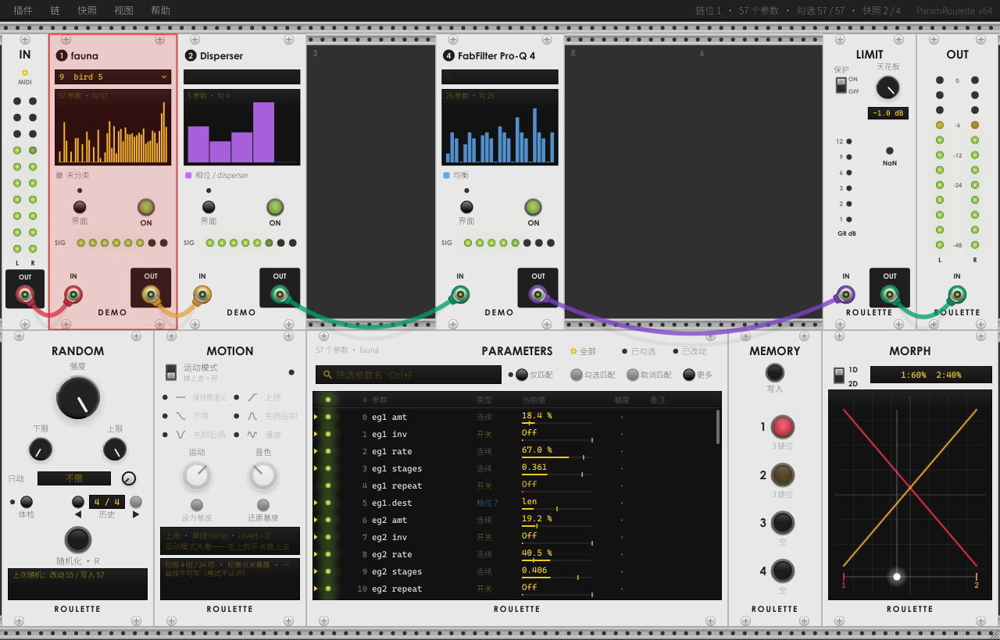
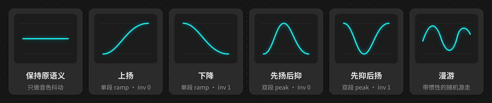
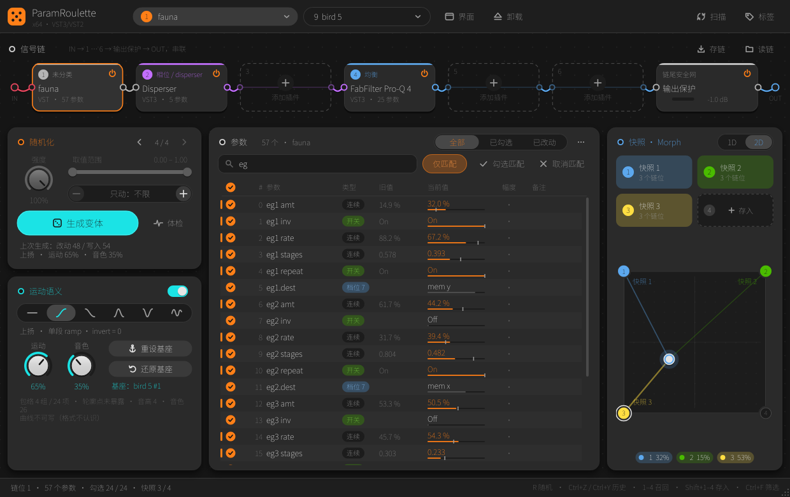
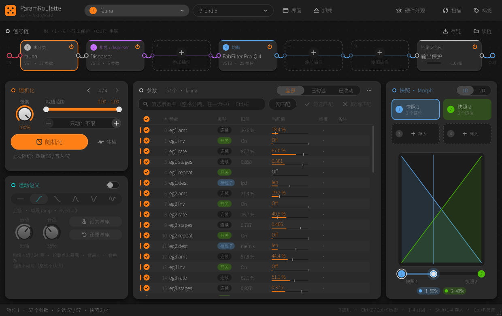
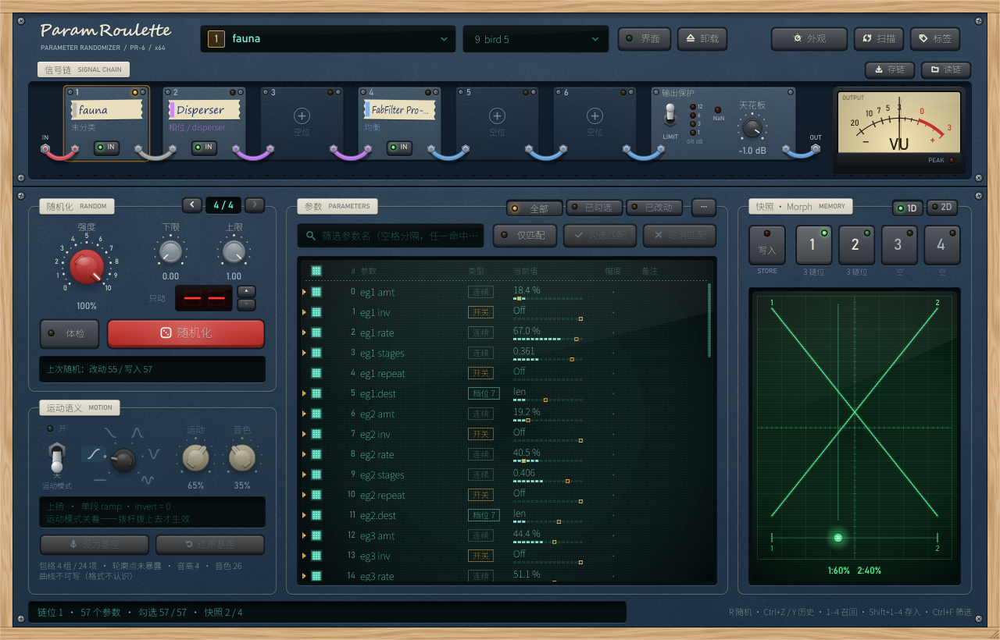
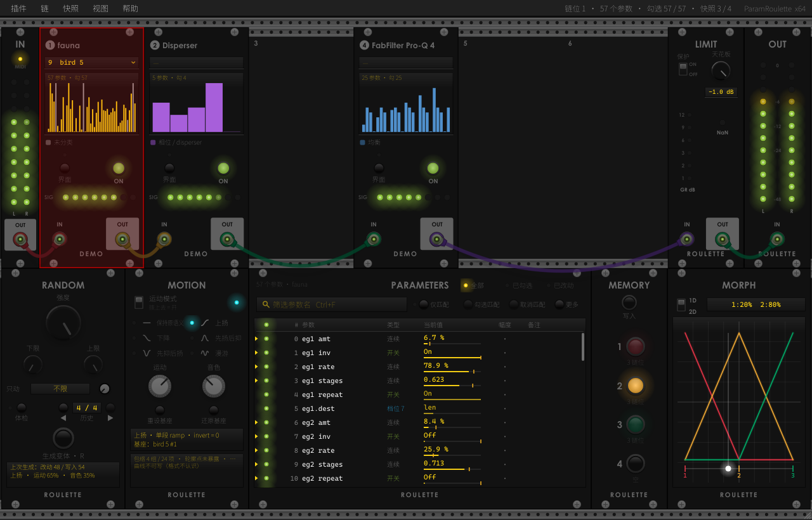
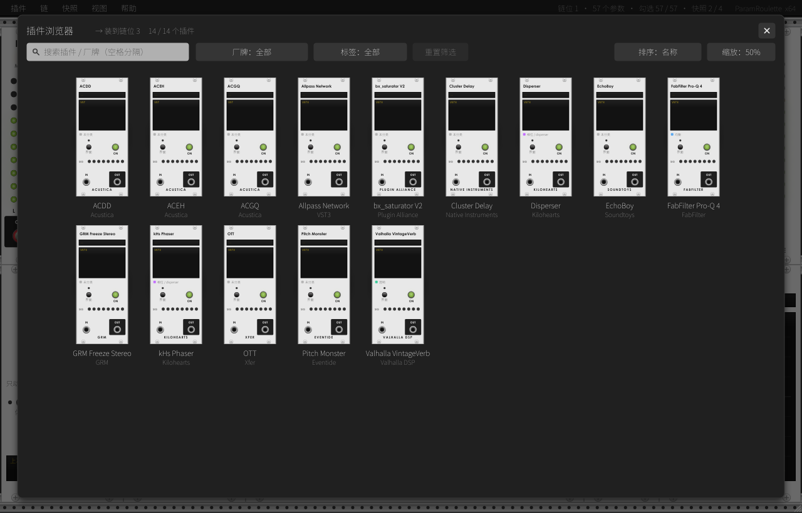

# ParamRoulette

**给插件参数转一次轮盘——转到喜欢的就存下来，在它们之间滑动。**

ParamRoulette 是一个 Windows 上的 VST3 宿主插件。在它里面串起最多 6 个插件，一键随机化它们的参数；把喜欢的结果存成**整条链**的快照，在快照之间平滑 morph；还能按「上扬 / 下降 / 先扬后抑」这样的**音乐意图**去生成变体，而不是逐个参数瞎掷。

*A VST3 host plugin for Windows: chain up to six plugins, randomize their parameters with intent, snapshot the whole chain and morph between snapshots. The interface is in Chinese.*


[它解决什么问题](#它解决什么问题) · [功能](#功能) · [三套外观](#三套外观) · [五分钟上手](#五分钟上手) · [版本与安装](#版本与安装) · [文档](#文档)



<p align="center"><sub>Rack 外观。默认是 Grid 外观，另外还有一套硬件拟物外观——三套随时切换，功能完全一样。</sub></p>

---

## 它解决什么问题

随机化是找新声音最快的办法，但普通的随机化器有几个老毛病。ParamRoulette 一个一个对着改：

| 老毛病 | ParamRoulette 的做法 |
|---|---|
| 随机到一个好声音，再点一下就回不去了 | **20 步历史**（Ctrl+Z / Ctrl+Y）+ **4 个快照**，每个快照存下整条链 |
| 一次动几十个参数，听不出是谁起的作用 | **每次只动 N 个**、勾选 + 关键词筛选、逐参数设定抖动幅度 |
| 包络、音高轮廓一个点一个点地随机，出来是噪声不是运动 | **运动语义**：先选运动的形状，再让相关的一组参数协同去实现它 |
| 有些参数怎么随机都不动 | **体检**：认出只收 0 / 1 的伪开关和只读参数，换成对的处理方式 |
| 随机出 +40 dB 的爆音，甚至 NaN 把整条总线污染掉 | **链尾安全网**：清掉非法样本、把峰值压到天花板以下，默认开着 |
| 一次只能随机一个插件 | **最多 6 个插件串成一条链**，整条链一起随机、一起存快照，还能存成预设跨工程复用 |

---

## 功能

### 随机化，但每一下都可控

- **按参数类型分别处理**：开关按「强度」当概率翻转；档位在范围里取目标后**随机取整**到合法档位（档位少的时候也不会卡在原地不动）；连续量在「取值范围」里取目标、按强度混合
- **强度 / 取值范围 / 每次只动 N 个**：从"轻轻推一下"到"整个重掷"，都是一个旋钮的事
- **勾选决定谁可以动**：在参数列表上按住拖动就能连续勾一整排；关键词筛选后一键「勾选匹配 / 取消匹配」。勾选**按插件记住**，下次加载同一个插件自动还原
- **结果看得见**：本次改动过的行会标出来，值条上留着旧值的刻度；结果栏分开写「改动 N / 写入 M」——有的插件会把写入弹回去，这里不虚报
- **随机化历史**：最多 20 步，每个链位各记各的——回退 EQ 不会把别的插件也拽回去

### 体检：先弄清楚每个参数收什么

有的插件把"开关"做成连续参数，只认 0 和 1，中间的值一律弹回去；有的参数对宿主是只读的。随机化碰上它们就是白忙。点一次「体检」，ParamRoulette 会逐个参数试着写几个值、再读回来：

- **只收端点**的伪开关 → 以后按开关处理，morph 时也不再对它取平均
- **写不进**的只读参数 → 提议把它们移出随机范围

体检是在真实地改参数，**会出声**，跑之前先把监听音量调低。

### 运动语义：按音乐意图生成变体



普通随机化把每个参数独立掷一遍。对包络、LFO、音高这类**有走向**的东西，结果是抖动而不是运动。运动模式反过来：**先选一个形状，再让相关的一组参数协同地去实现它。**

- **六种语义**：保持原语义 / 上扬 / 下降 / 先扬后抑 / 先抑后扬 / 漫游（上图里的 inv 指包络反相）
- **锁定基座**：每次都从同一个出发点生成变体，连点十次也不会越走越远
- **锚点交叉淡入**：不只给包络加深度，参数的静态值也朝方向拉——「上扬」才真的听起来是往上走
- **两层强度**：「运动」管方向和幅度，「音色」管围绕基座的细微抖动，两个都能在 DAW 里画自动化
- **逐参数幅度**：每个参数的抖动上限可以单独设，细到 ±0.01
- **按名字自动发现角色**：包络深度 / 反相 / 速率 / 段数、ADSR、音高、音色……猜错了也不会坏事，那个参数只是退回普通随机化
- **直接改写包络曲线**：有些插件的包络轮廓不是普通参数，而是藏在插件状态里的一串断点。对认得格式的插件（目前是 CK Envelope，比如 fauna），ParamRoulette 会读出状态、改写断点、再写回去；不认得的格式一律不碰。认出 fauna 时还会走一套逐参数试听验证过的专用配方

### 快照与 morph：在喜欢的声音之间滑动



- **4 个快照，每个存整条链**（6 个链位各存一份完整状态），召回是精确还原
- **1D**：存过的快照按序号排成一条线；**2D**：四个角各绑一个快照，拖到哪里就按位置混合
- **只插值能插值的**：连续量加权平均；开关、档位、调制目标这类选择器由权重最大的那个快照决定——选择器取平均只会得到第三个毫不相干的选项
- 某个链位换了插件，那一位自动跳过，其余照常插值
- Morph X / Y 是 DAW 参数，morph 的走位可以录成自动化

### 信号链与安全网

- **6 个链位串联**，音频和 MIDI 都按 1 → 6 往下传；每一位可以单独旁通；各位的延迟和尾巴（比如混响拖尾）自动求和报给宿主
- 每个链位的插件界面开在各自的浮动窗口里，可以同时打开对比
- **链尾安全网**：清掉 NaN / Inf → 峰值压到天花板（默认 −1 dBFS）→ 软削波兜底，保证输出不超过天花板。天花板以下 80% 的电平完全不碰，正常干活时听不出它在
- **链预设**：整条链（插件 + 状态 + 勾选表 + 逐参数幅度）存成一个 `.prchain` 文件，下一首歌直接读进来

### 插件功能标签

给插件标上它是干什么的：均衡 / 滤波器 / 全通 / 相位 / 延迟 / 混响 / 调制 / 动态 / 失真 / 变调 / 颗粒 / 工具。「按名字猜一遍」能自动填三成左右，剩下的手标。信号链上的模块和连线按标签着色——信号经过了谁、被怎么处理过，一眼就能看出来。

这些标签也是下一步「按配方随机组一条效果链」的数据基础。

### 和 DAW 配合

12 个宿主参数可以在 DAW 里自动化：`Morph X` · `Morph Y` · `Amount` · `Range Lo` · `Range Hi` · `Randomize` · `Morph Mode` · `Motion` · `Tone` · `Max Params` · `Ceiling` · `Output Guard`

`Randomize` 是一个触发器：在自动化里画一个 0 → 1 的跳变，就会在那一刻掷一次。

---

## 三套外观

| Grid（默认） | 硬件 | Rack |
|:-:|:-:|:-:|
| [](docs/ui-main.png) | [](docs/ui-hardware.png) | [](docs/ui-rack.png) |
| 照 Bitwig「The Grid」：深色点阵画布、圆角模块，信号连线按经过的插件变色 | 音频设备拟物：藏青面板、原木边框、胶木旋钮、VU 表、荧光屏、示波器 | 照 VCV Rack 2：导轨、下垂的彩色跳线、LED 屏、模块浏览器、"房间亮度" |

- **功能完全一样**，换外观不会关掉开着的插件窗口；选了哪套会被记住，别的实例、32 位 / 64 位版都跟着用这一套
- **每套都有自己的手感**：硬件版的旋钮拖动时隐藏光标，快照用「先按写入、再按数字」的硬件手势；Rack 版的旋钮照 VCV（Ctrl 微调、Shift 粗调、右键直接输入数值），**按住插件模块左右拖就能调串联顺序**，每个模块有自己的电平灯，信号死在了哪一位一眼能看出来

| Rack：深色面板 + 调暗房间 | Rack：模块浏览器 |
|:-:|:-:|
| [](docs/ui-rack-dark.png) | [](docs/ui-rack-browser.png) |

---

## 五分钟上手

以默认的 Grid 外观为例：

1. 在 DAW 里挂上 **ParamRoulette**（效果器）或 **ParamRoulette Synth**（乐器），打开它的界面
2. 第一次用：点顶栏的「**扫描**」，把你的插件目录加进去扫一遍
3. 点信号链上的空位，挑一个插件装上。想串一条链，就接着点下一个空位
4. 点「**体检**」（会出声，先把监听音量调低）
5. 按 **R** 随机化。不喜欢就 **Ctrl+Z** 退回去；喜欢就点右边快照区的空方块存起来
6. 存了两个以上的快照，拖 morph 控件在它们之间滑动
7. 想要"同一个声音的变体"：打开运动语义的开关，选一个形状（比如上扬），按 **R** 生成变体

两个小建议：

- 随机之前，先在参数列表里把不想动的取消勾选（总音量、路由选择器之类）。勾选按插件记住，配一次就够了
- 把「只动」设成 1~2，每次改动都听得出是哪个参数在起作用

更细的说明（每个控件、fauna 的实战配置、常见问题）在[使用手册](MANUAL.md)里。

---

## 操作速查

| 按键 | 作用 |
|---|---|
| **R** | 随机化 / 生成变体 |
| **Ctrl+Z / Ctrl+Y** | 历史后退 / 前进 |
| **1 – 4** | 召回快照 |
| **Shift+1 – 4** | 把整条链存进快照 |
| **Ctrl+F** | 筛选参数（Esc 清空） |
| **Enter** | 打开模块浏览器（Rack 外观） |
| **Ctrl+E** | 旁通当前模块（Rack 外观） |
| **Ctrl+← / →** | 当前模块左移 / 右移（Rack 外观） |

| 鼠标 | 作用 |
|---|---|
| 单击链上的模块 | 聚焦这一位：随机化、体检、参数列表都作用在它身上 |
| 双击模块 | 打开这个插件自己的界面 |
| 右键模块 | 打开界面 / 更换 / 旁通 / 卸载 |
| 在参数列表上按住拖动 | 连续勾选或取消一整排 |
| 双击旋钮 | 回到默认值 |
| 按住模块左右拖（Rack 外观） | 调整串联顺序 |

快捷键需要插件窗口有键盘焦点——点一下界面空白处就行。

---

## 版本与安装

Windows 不允许 64 位程序加载 32 位插件，反过来也不行，所以 ParamRoulette 分成 64 位和 32 位两套独立的插件，各有效果器版和乐器版：

| 插件 | 架构 | 能托管 | 适合 |
|---|---|---|---|
| **ParamRoulette** | 64 位 | 64 位 VST3（VST2 见下） | 效果器链 |
| **ParamRoulette Synth** | 64 位 | 同上 | 合成器，后面再接效果器 |
| **ParamRoulette x86** | 32 位 | 32 位 VST3 / VST2 | 老的 32 位效果器 |
| **ParamRoulette Synth x86** | 32 位 | 32 位 VST3 / VST2 | 老的 32 位合成器，比如 fauna |

每个版本还有一个同名的 Standalone `.exe`，不用装进 DAW，双击就开。在 64 位 DAW 里用 32 位版，需要 DAW 自带 32 位桥接（REAPER 有，会自动用上）。

### 编译

目前没有预编译的安装包，需要自己编译。准备 Windows、Visual Studio（C++ 桌面开发；本项目用 VS 2026 编译）和 CMake ≥ 3.22，JUCE 会由 CMake 自动下载：

```bash
cmake -B build -A x64
cmake --build build --config Release --parallel
```

产物在 `build/ParamRoulette_artefacts/Release/VST3/` 和 `build/ParamRouletteSynth_artefacts/Release/VST3/` 下。把 `.vst3` 文件夹整个拷进 `C:\Program Files\Common Files\VST3\`，重启 DAW 就能看到。

**托管 VST2** 需要你自己提供 Steinberg VST2 SDK 的两个头文件——本仓库不包含，也不能包含，见 [vst2sdk/README.md](vst2sdk/README.md)。没有它们 64 位版照样能编，只是只能托管 VST3；32 位版必须有。

32 位版的编译、一键安装脚本、源码结构和测试工具见[开发者指南](DEVELOPING.md)。

---

## 质量

- **无头测试**：32 位版真加载 fauna 跑一整套检查（92 项：参数分类、随机化、体检、运动引擎、曲线读写往返、快照、串联、安全网……），64 位跑其中不依赖 fauna 的纯逻辑部分（87 项）
- **界面截图工具**：三套外观都能无头画成 PNG、逐像素可复现；换外观再换回来，必须和直接打开的逐像素一致；拖模块、快捷键用真的鼠标 / 键盘事件验
- **pluginval 最高档**（strictness 8，含界面测试）：64 位效果器版和乐器版都通过
- 每个修过的 bug 的根因和证据都记在[验证记录](VERIFY.md)里

---

## 已知限制

- 只支持 Windows；只有 VST3 和 Standalone，没有 AU / CLAP / LV2
- 界面只有中文
- 被托管插件自己的参数不转给 DAW 自动化——能画自动化的是上面那 12 个宿主参数
- 链是纯串联，没有并联、分叉、干湿混合
- 改写包络曲线只支持认得格式的插件（目前是 CK Envelope）
- 「按配方随机组一条效果链」还没做；功能标签就是为它准备的数据

---

## 文档

| 文档 | 内容 |
|---|---|
| [MANUAL.md](MANUAL.md) | 使用手册：三套外观逐块说明、运动语义、快照与 morph、fauna 实战配置、常见问题 |
| [DEVELOPING.md](DEVELOPING.md) | 开发者指南：编译（含 32 位）、安装脚本、源码地图、测试工具 |
| [VERIFY.md](VERIFY.md) | 验证记录：每个功能的实测数据、每个 bug 的根因和证据 |

---

## 许可与致谢

ParamRoulette 以 [AGPLv3](LICENSE) 发布——它基于 [JUCE 8](https://juce.com)，JUCE 8 的开源授权就是 AGPLv3。

Steinberg 的 VST2 SDK 头文件**不在本仓库里**，也不随本项目分发（Steinberg 2018 年 10 月起停发 VST2 授权）。

VST 是 Steinberg Media Technologies GmbH 的注册商标；Bitwig、VCV Rack 等名称属于各自的所有者。本项目和它们没有任何关联，只是在界面设计上致敬。

- [JUCE](https://juce.com)：插件框架
- [Bitwig Studio 的 The Grid](https://www.bitwig.com/the-grid/)：Grid 外观的灵感来源
- [VCV Rack](https://vcvrack.com)：Rack 外观的设计参考，配色、线缆、元件的数值取自它的[开源代码](https://github.com/VCVRack/Rack)
- [pluginval](https://github.com/Tracktion/pluginval)：插件合规测试

ParamRoulette 的前身是一个 REAPER 里的 ReaScript 随机化脚本，最初是为了给 32 位物理建模合成器 fauna 做变体而写的；后来做成了 Windows 上支持 VST3 的宿主都能用的插件。
