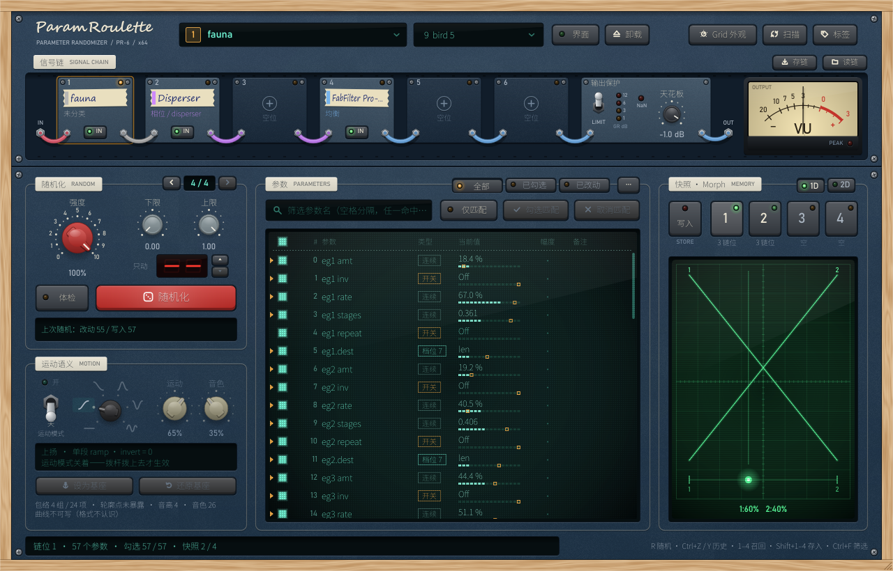

# ParamRoulette 验证清单

## 三条验收标准的实测结果

用 `pr_probe.exe`（32 位无头测试程序，真加载 fauna、真跑逻辑）验的，不是断言。
重跑：

```bash
cmake --build build32 --target pr_probe --config Release --parallel && "./build32/pr_probe_artefacts/Release/pr_probe.exe" > probe_out.txt
```

### ① VST2 32 位 fauna 必须能加载 —— **通过**

```
registered formats : VST3, VST
JUCE_PLUGINHOST_VST: 1
file               : C:\Program Files (x86)\VSTPlugIns\fauna.dll
descriptor         : fauna  [VST]  VSTi
instantiated       : OK
bus layout         : in 0 / out 2
parameters         : 178
```

178 个参数（REAPER 里看到 181 是因为 REAPER 自己额外加了 Wet / Bypass / Delta 三个）。

### ② 部分参数无法随机化 —— **通过**

fauna 的 **178 个参数全部**上报为「连续」（`toggle/stepped/cont: 0 / 0 / 178`），
一个都没有档位信息。三值体检认出其中 **23 个是伪二值**：

```
ok / endpoint-only / inert / untested : 151 / 23 / 0 / 4
eg1~4 LIR、eg1~4 inv、lfo1~3.sync、loud、send1~9.inv、spl.1/2.inv
```

`inert` 是 0 —— fauna 不拒绝任何写入，它是**把中间值吸到最近端点**。所以真正的
死锁只在低强度下出现，实测：

```
强度 0.30，40 次，跟踪 eg1 inv 实际翻转次数：
  当成连续处理（修复前） : 0 / 40   ← 一次都不动
  当成开关处理（修复后） : 4 / 40
```

**0 / 40 就是你说的「不管我怎么随机都是在 10」。** 体检认出来之后随机化只写
`0.0` / `1.0` 两个精确端点，它才开始动。列表里这 23 行备注是琥珀色的「只收端点」。

### ③ 曲线必须能随机化 —— **通过**

fauna 的 4 条 16 段包络**不是普通参数**。参数表里只有四个叫 `CK_GUI_Envelope_16`
的项，值是不透明二进制串，`setValue(float)` 表达不了 16 个断点。所以
`contour points: 0` —— 走参数这条路曲线永远动不了。

唯一的路是插件自己的状态块。实测（只改 EG4，从基座派生）：

```
state size         : 239304 bytes
contour groups     : 4   <-- recognised
current program    : 0 / 128   name "blank"

round-trip write test on EG4 (group 3) only, base-derived:
  wrote 1 contour(s), stages 1
  EG4 levels[0..3] : 1.000 0.000 0.000 0.000     <- 单段 ramp
  EG4 times [0..3] : 0.699 0.000 0.000 0.000
  EG3 untouched    : YES  OK
  plugin blob param changed : YES - plugin accepted the write
  drift test (8 gens): 1.324 0.864 1.158 0.820 0.698 0.832 0.973 1.261   <- 不累积
  program mismatch guard : aborts  OK
  RESULT: PASS
```

`plugin blob param changed: YES` 是关键那行：fauna 自己的 `CK_GUI_Envelope_16`
参数值文本变了，说明它重读了状态并接受了写入。

### fauna 配方（采纳 codex 的试听结论）

认出 fauna 的参数命名后走这一套，不再用通用启发式：

```
sem 1 上扬   : inv=10.000  dest=tens  tens=5.751  stg=1.000  eg3amt=0.000
sem 2 下降   : inv=-10.000 dest=tens  tens=1.851  stg=1.000  eg3amt=0.000
sem 3 先扬后抑: inv=10.000  dest=tens  stg=2.000
sem 4 先抑后扬: inv=-10.000 dest=tens  stg=2.000
sem 0 保持   : dest=r1  eg3amt=3.694   <- 原值不动
```

- `dest=tens`：不把 EG4 目标指到 tension，深度加再多都听不出音高在动（codex 实测）
- `eg3amt=0`：EG3→length 在 bird 5 上 amount 0 和 10 渲染完全相同，关掉
- `stg=1/2`：`(stages-1)/15.9` 换算，ramp 1 段 / peak 2 段
- tension 按方向拉锚点（上扬 0.25 / 下降 0.85），因为基座已贴上限、没有调制余量

### 三条和 codex 规格不一致的地方（都有实测依据）

**1. 字节偏移是 11 / 91，不是 15 / 95。**

```
records whose byte[marker+8] == 0xEB : 512 / 512   ← 0xEB 是每记录长度前缀，记录起点 = marker+8
rel 11 : 491 / 512 是 0.0    ← 我们的 level[0]（包络从静音起）
rel 16 : 226 / 512           ← codex 的 level[0]
rel 91 : 512 / 512 是 0.0    ← 我们的 time[0]（第一个断点在 t=0）
rel 96 : 2 / 512             ← codex 的 time[0]
```

`rel 91` 512/512 全是 0（第一个断点在 t=0，包络的通用约定）；按 codex 的对齐那是
level[15]，每条记录最后一个电平都是 0 说不通，而他的 time[0] 510/512 非零更说不通。
codex 的 15/95 对 REAPER 的 track chunk 是对的（那边插件数据前多几字节头），
对 `getStateInformation` 拿到的块偏 5 字节。

**2. codex 的 `getText` 静音检测在 JUCE VST2 宿主里不成立。**

```
probe found pseudo but getText missed it: 23   ← 全部漏掉
eg1 inv   0="0"  0.5="0.5"  1="1"
tens      0="0"  0.5="0.5"  1="1"     ← 连续参数也一样
```

VST2 协议没有"格式化一个假设值"的 opcode（`effGetParamDisplay` 只格式化**当前**值），
所以 JUCE 的 `getText(normalized)` 退回成 `String(value)`，根本没问过 fauna。
codex 那招在 REAPER 里能用是因为 REAPER 有 `TrackFX_FormatParamValueNormalized`。
所以这里保留写-读三值探测。

**3. 通用引擎多一个「漫游」语义**，方向每次随机（否则在 fauna 上恒等于下降）。

---

## preset 选择器（新增）

顶栏右边加了 preset 下拉。**这个不是锦上添花** —— 轮廓改的是**当前 program**
那条记录，而 fauna 的 program 0 叫 `blank`（四条包络内容一模一样，改了也听不出）。
没有选择器就只能在 blank 上转圈。

实测 fauna：

```
getNumPrograms()   : 128        named programs : 128 / 128
first 24 : 0:blank  1:alligator  2:bear 1 ... 5:bird 1 ... 9:bird 5  10:bird 6 ...
bird 5 index       : 9
切过去后 EG4 轮廓：
  blank : 1.00 0.00 0.00 0.00 ...   (used 1)
  bird 5: 0.00 0.98 0.39 0.54 ...   (used 4)
contours differ per program : YES
bird 5 的 tens 基座 : norm 0.8250   ← codex 说"约 0.85，没有向上余量"，独立对上了
```

**切 preset 会清掉运动模式的基座**（基座记的是另一个 program 的参数和轮廓，
留着只会让下次生成被 program 校验挡掉）。不自动重锁——下次「生成变体」会自动
锁当前状态。

只有 1 个 program 的插件（大多数 VST3）下拉会置灰。

---

## 拖动涂抹会连带刷掉一整片（已修，真 bug）

现象：列表滚下去之后，**单击一行会把上面一整段的勾选状态一起改掉**。
第一次实测就中了——fauna 的排除表被存成"177 / 178 个参数被排除"，
于是重新加载后一个都没勾，随机化静默无事发生。

根因在 `ParamListView::rowsMouseDown`：它启动了边缘自动滚动的定时器，
但**没有初始化 `dragYInViewport`**，那个值保留上一次拖动的残值（初始 0）。
`0 < kEdgePx(14)` 让定时器判定"鼠标贴着顶边" → 往上滚一行 → 然后把
"顶行 → lastPaintedRow" 整段涂成同一个值。

修法：`rowsMouseDown` 里加 `dragYInViewport = e.getEventRelativeTo (&viewport).y;`

**顺带加的防呆**：勾选数为 0 时状态行整条变琥珀色并写明
「一个都没勾，随机化不会有任何变化——点「全选」」。勾选状态是**按插件持久化**的
（跨实例记忆，从 Lua 版刻意移植过来的行为），所以那个 0 可能是上次留下的，
不说出来就是个静默陷阱。

如果你现在打开还是 0：**点一下「全选」** 就会重新存盘。

---

## morph 的"叠加感 / 声音变大"（已修，真问题）

**先说清 pad 是什么**：只有**一个**子插件实例（`std::unique_ptr<AudioPluginInstance> hosted`），
morph 做的是**参数值插值**，没有任何音频混合、没有播四遍。

但"叠加感"有实在原因：fauna 的 **178 个参数全部上报为「连续」**（实测
`toggle/stepped/cont: 0 / 0 / 178`），所以 morph 把**枚举型选择器也当连续量插值**了。
在 `dest=r1` 和 `dest=tens` 之间取平均，得到的是**第三个毫无关系的调制目标**。

实测被误插值的有 **40 个**：

```
4 个 eg*.dest    9 个 send*.dest    9 个 send*.src    6 个 lfo*.dest
6 个 lfo*.wave   3 个 lfo*.rate.type   3 个 lfo*.sync
```

18 个调制目标 + 9 个调制源同时被接到随机位置 —— 那当然是凭空多出好几层而且更响。

修法：`ParamInfo::noInterpolate`，按名字认出选择器类参数
（`dest` / `src` / `route` / `wave` / `type` / `mode` / `sync` / …），
morph 对它们改用**权重最大者胜出**而不是求平均。

**randomize 不受影响** —— 随机挑一个调制目标是合理的，只有插值要守这条。

反向抽查确认没误伤：`tens` / `trans` / `throat f` / `r1-1` / `mem x pos` 仍然正常插值。

另外提醒：即便修好了这一条，**共振器组取平均在听觉上也不是淡入淡出**。
两组不同频率的共振器平均出来是第三组，能量可能反而更满。这是物理建模合成器的
固有性质，不是 bug —— 想要干净的过渡就少勾一些参数（用「仅勾选」视图看清范围）。

---

## 列表可用性（新增）

- **序号列**：参数下标回来了。它本身就是筛选线索（fauna 的 eg4 那组是 40-49）。
- **显示范围下拉**：`全部` / `仅勾选` / `仅改动`。和关键词 filter 是两条独立筛选，
  同时生效。「仅勾选」回答"我到底勾了哪些"；「仅改动」回答"这次随机动了什么"。
- **旧值 → 新值**：每次随机化 / 生成变体之后，改动过的行会显示
  `旧值` 和亮青色的 `→ 新值`。
- **"改动"计数改成按读回来的差异算**，不再用"写了几次"。插件把写入吸附或原地
  弹回时，"写了几次"是虚高的——fauna 上尤其明显。

列布局：`勾选 | 序号 | 名字 | 类型 | 旧值 | 当前值 | 备注`

---

## 界面中文乱码（已修）

界面上所有中文显示成 `未 åŠ è½½` 这类乱码。根因**不是** `/utf-8`，也不是字体：

```cpp
// juce_String.cpp:307
String::String (const char* const t)
    : text (StringHolderUtils::createFromCharPointer (CharPointer_ASCII (t)))
//                                                    ^^^^^^^^^^^^^^^^^^

// juce_CharPointer_ASCII.h:90
juce_wchar operator*() const noexcept { return (juce_wchar) (uint8) *data; }
//                                             每个字节当一个码点 = Latin-1 语义
```

"未" 的 UTF-8 字节 `E6 9C AA` 被当成三个码点 `U+00E6 U+009C U+00AA`，于是显示成
`æ` + 控制字符 + `ª`。JUCE 自己在那个构造函数里就写了注释说这件事会发生，并要求
"you must be more explicit"（Release 构建里那句 assert 被编掉，所以它是静默的）。

**`/utf-8` 解决不了**：它保证字面量里躺着正确的 UTF-8 字节，而 JUCE 怎么解释这些
字节是 JUCE 的事。

修法：加了 [Utf8.h](Source/Utf8.h) 里的 `_u8` 字面量后缀，走 `CharPointer_UTF8`。
用词法扫描（跳过注释 / 字符字面量 / 预处理行，并把相邻拼接分组）机械改写了
8 个文件里 **140 个字面量组**。

回归测试逐字节比对：

```
OK   motionSemanticLabel(Rise)   len 6  e4 b8 8a e6 89 ac        <- 上扬
OK   kindLabel(Toggle)           len 6  e5 bc 80 e5 85 b3        <- 开关
OK   healthLabel(EndpointOnly)   len 12 e5 8f aa e6 94 b6 ...    <- 只收端点
OK   roleLabel(EnvInvert)        len 12 e5 8c 85 e7 bb 9c ...    <- 包络反相
RESULT: PASS - no mojibake
summary() = 包络 4 组 / 47 项（含 ADSR 8 段）  ·  音高 11  ·  音色 38
```

**以后加中文字面量必须带 `_u8` 后缀**，否则又是乱码。纯 ASCII 的不用加。

**现在有工具专门查这个**：`node Tools/check_utf8_literals.mjs`。
它认 `_u8` 后缀和 `String::fromUTF8()` 两种安全写法，跳过注释 / 字符字面量 /
预处理行，并且知道相邻字面量会拼接（后缀只需在最后一个上）。
当前状态：**30 个文件全部干净**。

写这个工具时它先报了一处误判——`ParamListView.cpp:283` 的 `"→ "`，
实际上那行用的是 `juce::String::fromUTF8`，是安全的。**看了才改**，
没有盲目"修"掉一个本来正确的地方。

---

## 本轮新增（工作流 + 多插件链）

### 无头测试：48 项纯逻辑检查，两个架构都跑

最容易出错的三块逻辑被抽成不依赖 `JucePlugin_*` 宏的独立单元，
这样才进得了探针（`PluginProcessor` 链不进去）。测试在
`Tests/ProbeFauna.cpp` 的 **section 0**，**不需要任何插件**：

```
=== 0. PURE LOGIC (no plugin needed) ===
  HistoryRing（回退/前进的游标算术）        12 项
  subsample（每次只动 N 个）                 5 项
  OutputGuard（链尾安全网，纯 DSP）          9 项
  ChainRunner（串联 / 旁通 / 声道不足）      17 项
  快照身份校验                                5 项
  pure logic: ALL PASS
```

几项值得单独说，都是"错了不崩、只会悄悄不对"的那类：

| 检查 | 防的是什么 |
|---|---|
| `push after undo truncated the future` | 回退后再掷一次，旧的"下一个"必须被砍掉，否则「▶」会走到一条已经被覆盖的分支 |
| `cursor follows pop_front (back gives T9)` | 历史超上限丢头部时游标要一起前移，不移就会指向另一条记录 |
| `every candidate is reachable (no off-by-one bias)` | 部分 Fisher-Yates 写错一个下标会让最后一个候选永远选不到——500 次抽样验证 10 个候选都出现过 |
| `audio passes through every link in order` | 三个"加常数"的假插件串起来必须得 0+1+2+4 = **7**。只有真串对了才是 7 |
| `insufficient scratch is reported, not overrun` | 暂存区不够时必须跳过而**不是越界写**，并且验证插件根本没被调用 |
| `gain persists across blocks` | limiter 的增益跨块保持。每块重置成 1.0 的话，持续超标的信号会在每个块边界重新过冲，听起来是周期性爆裂 |

### 链尾安全网的实测

```
输入 40.0（+32 dB，典型的反馈炸开）→ 输出 ≤ 0.891（−1 dBFS）   ✓
输入 1.0e6                          → 输出 ≤ 0.891，且全部有限   ✓
输入含 NaN / +Inf / −Inf            → 全部清零，latch 报警        ✓
guard 关掉时灌 NaN                  → **仍然清零**                ✓
输入 0.25（knee 以下）              → 原样输出，误差 < 1e-6       ✓
```

最后一条是"透明性"：天花板以下 80% 的电平完全不碰。
全程 `tanh` 的话 u=0.5 处就有 4% 误差，那是把所有正常电平都染色了。

### 快照身份校验（修掉一个我自己引入的 bug）

多插件链**引入了一个单插件时代不存在的 bug**：`restoreSnapshot` 原来直接
把 `childState` 喂给传进来的插件，不做任何校验。有了 6 个链位之后，
"在链位 1 存快照、切到链位 2 召回"只差一次点击，而那团字节只有原插件认得。

修法是记下身份并在还原前校验：

```
snapshot records the plugin it came from        ✓
legacy snapshot (no id) is left permissive      ✓   老工程放行（那时链上只有一位）
plugin id survives the ValueTree round trip     ✓   重开工程后校验依然有效
```

`applyMorph` 原来只比参数**个数**——同厂姊妹产品、同插件两个版本参数数相同
一点都不罕见，那时插值出来的是两组无关值的平均。现在先比身份再比长度。

### 32 位回归：refactor 没碰坏 fauna 那条路

重构（单插件 → 6 链位数组）之后重跑 32 位探针，14 组全绿、退出码 0：

```
instantiated       : OK          参数 178
ok / endpoint-only / inert / untested : 151 / 23 / 0 / 4
低强度 0.30 翻转率：as Continuous 0/40  →  as Toggle 4/40
contour groups     : 4   <-- recognised
  EG3 untouched    : YES  OK
  plugin blob param changed : YES
基座测试 near A: 1   near B: 5   → engine ok
UTF-8: RESULT: PASS - no mojibake
```

三条原始验收标准（fauna 能加载 / 参数能随机 / 曲线能随机）**在重构后依然成立**。

### 工程状态 v2 → v3

`HOSTED` 从单个子节点变成多个、每个带 `slot` 属性。
**版本判据是"HOSTED 有没有 slot 属性"**——v2 只有一个且没有它。

| | v2 存在哪 | v3 存在哪 |
|---|---|---|
| 子插件 desc / state | 唯一那个 `HOSTED` | 每个 `HOSTED`（带 `slot`） |
| 勾选表 `excluded` | **根**上 | 各自的 `HOSTED` 里 |
| 运动基座 `MotionBase` | **根**上 | 各自的 `HOSTED` 里 |
| 新增 | — | `focused` / `bypass` / `ceiling` / `guardOn` / `maxParams` |

读 v2 工程时：唯一那个 HOSTED 装进链位 0，勾选表和基座从根上取。
`ceiling` / `guardOn` 缺省成"开着、−1 dB"——**老工程升上来自动获得保护**。

链位是**逐个顺序加载**的，不是一起发：`loading` 是一个标志，
并发加载会被挡掉，结果只有第一个成功、剩下的静默丢失。
某一位加载失败（插件卸载了 / 换机器了）**不中断整条链**，
否则一个坏插件会让整个工程变空。

### 产物（8 个，架构已核对 PE 头）

| 架构 | 产物 |
|---|---|
| x86 | `ParamRoulette x86.vst3` / `ParamRoulette Synth x86.vst3` + 两个 `.exe` |
| x64 | `ParamRoulette.vst3` / `ParamRoulette Synth.vst3` + 两个 `.exe` |

两棵树全量重编，**零 error 零 warning**。

### 还没做的（别当成做了）

- **配方引擎本身没写** —— 「按配方随机选插件」和"神奇按钮"都还不存在。
  这一轮做完的是地基：多插件串联 + 输出天花板 + 链预设 + 功能标签录入
- **功能标签不驱动任何自动行为**，目前纯粹是给下一步用的数据
- ~~pluginval 没跑~~ —— **后来跑了**，见第 2 节：64 位两个产物在 strictness 8
  下都 SUCCESS，含 `Plugin state` / `Plugin state restoration`。
  32 位那两个验不了（pluginval.exe 是 64 位的）。

---

## 第二轮新增（链级快照 / 链预设 / 逐参数幅度 / 功能标签）

### 无头测试涨到 84 项（32 位）/ 79 项（64 位）

新增的几组：

```
快照 v2/v3 格式往返            7 项   —— 含"靠 pos 属性定位而不是靠子节点次序"
guessTag 名字关键词猜标签      24 项  —— 含 6 项实测踩到的假阳性回归
```

### guessTag：两个实测打脸的假阳性

写完规则表跑测试，立刻挂了两条。都是**子串匹配在短模式上不安全**：

| 输入 | 错判成 | 原因 |
|---|---|---|
| `bx_bluechorus2` | 延迟 | `"bluechorus"` 里含着 `echo`（e-c-h-o），而延迟规则排在调制前面 |
| `FabFilter Pro-Q 4` | 未分类 | "Pro-Q" 里压根没有 `eq` 这个子串 |

顺手推演出另外三个同类陷阱并钉成了测试：

```
frequency 里的 eq   不该判成均衡     （否则任何带 freq 的插件都变均衡器）
bottle    里的 ott  不该判成动态
combo     里的 comb 不该判成滤波器
```

改法两条：
1. `eq` / `ott` / `comb` 改成**整词匹配**（两边必须是非字母数字或字符串边界）
2. **调制类规则挪到延迟类前面**。这个顺序两头都对：`bluechorus` 先命中
   `chorus`，而 `EchoBoy` 里没有调制关键词，照样命中 `echo`。
   —— `Echoboy 仍然是延迟` 这条测试就是钉这个的

长而独特的模式（`disperser` / `granul`）继续用子串，还能顺带盖住
`Wavefolder` 这种词中出现的情况。

### 一个查错工具本身的假阳性（已修）

`check_utf8_literals.mjs` 报了 24 处"漏 `_u8`"，但那些输出在终端里**显示是正常的**。
查了 JUCE 源码才发现是**工具错了**，而且原因值得记下来：

| 路径 | JUCE 实际用的解码 | 结果 |
|---|---|---|
| `juce::String ("中文")`（构造函数） | `CharPointer_ASCII` | **乱码** |
| `someString + "中文"`（`operator+=`） | `CharPointer_UTF8` | 正确 |

见 `juce_String.cpp:773`，那里还留了句注释说用 UTF8 是因为 code-path 更快。
也就是说同一个字面量安不安全，取决于它落在哪个重载上。

**没有改工具去容忍这个例外，而是把规则统一成"无条件加后缀"**：
探针里那个 `check()` 的形参从 `const char*` 改成 `const String&`，
24 处补上 `_u8`。理由是没人记得住这个不对称，而加后缀永远正确、代价只是三个字符。
这条不对称记进了 `Source/Utf8.h`。

（同一个工具在这一轮**真抓到了三处**我自己新写的漏后缀：`·` / `±` /
链预设的一句错误提示。它有价值，只是判据要准。）

### 快照从"单插件"变成"整条链"，顺带修掉一个自己引入的 bug

上一轮的多插件链**引入了一个单插件时代不存在的问题**：`restoreSnapshot`
原来直接把 `childState` 喂给传进来的插件，不做校验。有了 6 个链位，
"在链位 1 存快照、切到链位 2 召回"只差一次点击，而那团字节只有原插件认得。

`applyMorph` 更隐蔽 —— 它只比参数**个数**，而同厂姊妹产品、同插件两个版本
参数数相同一点都不罕见，那时插值出来的是两组无关值的平均。

修法：`Snapshot` 记下 `pluginId`，还原前校验；**每链位各自比**，
某一位换了插件就跳过那一位、其余照插值。老工程的快照没这个字段 → 放行
（那时链上只有一位，混不起来）。

### 状态格式

| | 工程状态 | 快照 |
|---|---|---|
| v2 | 单个 `HOSTED`，勾选表和基座在根上 | `SLOT` 自己就是一份 Snapshot |
| v3 | 多个 `HOSTED`（带 `slot`），勾选表 / 基座 / 幅度在各自的 `HOSTED` 里 | `SLOT` > `CHAINPOS`（带 `pos`） |

两边都靠"有没有那个新属性 / 子节点"分辨版本，v2 一律装进链位 0。

**链预设和工程状态共用同一棵树**（`buildStateTree`）。故意的：格式分两套的话，
"存工程能还原、读预设还原不了"这种偏差只会在用户真去读预设时才暴露。

### 产物

两棵树全量重编，**零 error**。8 个产物，架构已核对 PE 头。

> **更正（第三轮发现）**：这里原来写的是"零 error 零 warning"。那是增量构建的结果——
> 增量构建不重编 JUCE 模块，所以看不到 JUCE 自己的警告。真正全量重编时，
> JUCE 的 `juce_VST3PluginFormat.cpp` 会报 2 条 C4458（734 / 770 行，局部变量 `iid`
> 遮住了类成员），每个 target 都有。那是第三方代码、一直都在，**我们自己的代码是零警告**。

---

## 第三轮：界面重做（Bitwig The Grid 风格）

### 怎么验证的：先造一个能"看见"界面的工具

插件界面只有在 DAW 里才看得到，而写代码的这一方看不到原生窗口——
不解决这一点，所有视觉改动都是盲改。所以先写了 `pr_uisnap`（`Tests/UiSnapshot.cpp`）：

- 构造**真的** processor + editor（不是 mock）
- 通过测试专用的 `installForTesting()`（`PR_TEST_HOOKS`，正式插件里不存在）同步装几个假插件，
  参数名照着 fauna 起，所以角色识别、运动 profile 都有真实内容
- 设置文件重定向到 `ParamRoulette-uisnap.settings`，不碰真正的插件表
- 渲染五张图：主界面 / 运动模式 + 2D / 空状态 / **最小尺寸** / 标签窗口

改动前先出了一张基线图，确认了问题（一堆默认控件堆成一张表单、「只动」那个步进器
画成了 `0 [-][...]`、morph 下面一大片空白）。之后每一轮改动都重新出图再看。

### 视觉依据

配色不是凭感觉挑的：从 Bitwig 官网和用户手册的 Grid 截图上**逐像素取样**——
画布 `#151515`、模块 `#2A2A2A`、强调橙 `#FF7F17`、旋钮白面 `#E5E5E5`，
以及 inspector 里那排模块调色板的九个色。唯一刻意的偏离是圆角：
Bitwig 原版只有 3~4px，按需求做成了卡片 14px、模块 12px、按钮全胶囊形。

### 出图之后才发现的问题（都已修）

| 问题 | 怎么发现的 | 修法 |
|---|---|---|
| **最小尺寸下参数名整列消失** | `04_min.png`：1100 宽时中间栏只剩 ~470px，固定列宽加起来超了，名字列被挤成零宽 | 列表按宽度取舍列：旧值 → 备注 → 类型依次收起，名字 / 当前值 / 幅度一直保留；两侧栏也跟着窗口宽度缩放 |
| 图标按钮的字被截成省略号（「体检」→「…」、「勾选匹配」→「勾选…」） | `01_main.png` | 内边距算得太大；放不下时先吃掉内边距 |
| 快照方块里名字和"3 个链位"压在边框上；空方块的「+」和「存入」重叠 | `01_main.png` | 徽章竖直居中、文字放右边；空方块改成一行「+ 存入」 |
| 空状态下 1D morph 的提示折行压在轨道上 | `03_empty.png` | 提示改成盖住整块 pad 的半透明层 |
| 1D morph 一根细线配一大片空白 | `01_main.png` | 上半部分画每个快照的**权重曲线**（直接拿 `computeWeights` 采样，不另写公式） |
| 标签窗口搜索框的占位字贴着上边 | `05_tags.png` | 补了竖直居中 |

### 读代码时发现的一个上一轮留下的真 bug（已修）

**切换链位之后，参数列表还在显示链位 1 的参数。**

`ParamListView` 在构造时绑的是 `proc.getModel()` 的**引用**——那一刻聚焦的是 `chain[0]`。
上一轮把单插件改成 6 链位之后，`getModel()` 改成返回"当前聚焦链位"的模型，
但列表手里那个引用永远指着 `chain[0]`。结果：切到链位 2，顶栏和随机化都作用在链位 2，
**列表却还在画链位 1 的参数**，勾选也勾在链位 1 上。

无头探针看不到 editor，所以没被测出来。修法：列表改成持有指针，
editor 每次结构变化（换链位 / 换插件 / 恢复工程）都 `setSource()` 重新指一遍。

### UTF-8 检查工具这一轮又抓到两个**真**乱码

新写的界面代码里有两处 `"中文" + juce::String` 的写法：

```cpp
"基座："  + proc.getMotionBaseLabel()     // 运动语义卡片里的基座标签
" · "     + proc.getSlotName (chainSlot)  // 信号链右键菜单的标题
```

`const char* + String` 走的是 `String (const char*)` 构造函数——也就是 ASCII 解码，
**界面上会是乱码**（和上一轮那 24 个"假阳性"正好相反：那边是 `String + const char*`，
走 `operator+=`，是 UTF-8 解码）。这正是"一律加 `_u8`、别去记哪个重载安全"那条规则的价值。
同一轮一共抓到 13 处，全部改成 `_u8`。

### pluginval：这一轮**打开了界面测试**

以前一直带 `--skip-gui-tests`。界面整个重写了，这次去掉它：

| 产物 | 结果 | 测试组 |
|---|---|---|
| `ParamRoulette.vst3`（64 位） | **SUCCESS** | **25**（多出 `Editor`、`Open editor whilst processing` 等） |
| `ParamRoulette Synth.vst3`（64 位） | **SUCCESS** | **25** |

`Open editor whilst processing` 是在音频线程跑着的时候反复开关编辑器——
这一轮编辑器的构造 / 析构顺序（LookAndFeel、提示气泡、缓存背景、子插件窗口钩子）全换了，
这组测试过了比较让人放心。

### 回归

- 32 位探针 **84 / 84**、64 位探针 **79 / 79**，三条原始验收标准照旧
- 两棵树全量重编：我们的代码零警告（JUCE 自己那 2 条 C4458 见上面的更正）
- `node Tools/check_utf8_literals.mjs`：42 个文件全部干净

### 没做的 / 没法验证的

- **截图是软件渲染器画的**，DAW 里实际走 Direct2D，字体的抗锯齿会略有不同，布局一致
- **弹出菜单、提示气泡、对话框截不到**（它们是单独的窗口）；样式是按 JUCE 源码确认过
  渲染路径写的：菜单底色故意带一点透明，JUCE 才会把菜单窗口设成非不透明、圆角才画得出来
- **对话框（体检确认、存链）是方角的**：JUCE 的 `TopLevelWindow` 在构造时就把自己设成
  不透明窗口，圆角外面画不出透明。里面的样式是统一过的
- 快捷键在 DAW 里要插件窗口有键盘焦点才生效；REAPER 里 R 键会不会和宿主快捷键冲突，
  **要你实测**

---

代码已在 MSVC 14.50 / VS 18 2026 上编译通过。下面的测试**你自己跑**——
我没连 REAPER 的 MCP，也不会替你点。

## 第四轮：硬件拟物皮肤（和 Grid 版并存）



要求是"**不要覆盖掉之前的**，单纯复制并修改 UI 成音频拟物风"。做法是把界面拆成三层，
两套皮肤共用**同一份行为**：

| 层 | 文件 | 管什么 |
|---|---|---|
| 外壳 | `PluginEditor` | DAW 拿到的 editor。持有当前皮肤、子插件窗口、扫描 / 标签窗口、两套 LookAndFeel；换皮肤 = 删掉旧皮肤建新的 |
| 行为 | `EditorBase` | 菜单、体检、链预设、快捷键、状态栏文案、参数写回、刷新节奏——一个功能只写一遍 |
| 皮肤 | `GridEditor` / `HardwareEditor` | 控件、布局、绘制、"控件 ↔ 状态"的同步 |

`GridEditor` 是原来 `PluginEditor` 的**原样搬家**（布局常量、控件、文案一个没改），
只是把"做什么"那部分挪到了 `EditorBase`。硬件皮肤的控件全是新写的
（`HwTheme` / `HardwareLookAndFeel` / `HwWidgets` / `HwPanels`），
参数列表、信号链、morph 这三个大件是在 Grid 版组件上**派生、只换画法**——
拖动涂抹勾选、点击判定、权重语义这些容易错的逻辑不复制第二份。

### Grid 版到底变没变：逐像素比对

截图工具加了固定随机种子（`seedForTesting`），同一份代码出的图逐像素一致。
改之前先出了两遍基线（`build/ui_base_a` / `_b`，两遍完全一样），改完逐像素比：

| 图 | 结果 | 差异在哪 |
|---|---|---|
| `05_tags`（标签窗口） | **一模一样** | — |
| `03_empty`（空状态） | 只有顶栏一块 71×14 | 新加的「硬件外观」按钮（入口总得有个地方） |
| `01_main` / `02_motion` / `04_min` | 顶栏那一块 + 快照方块上的一圈描边 | 后者是**修了个真 bug**，见下 |

**顺带修掉的 bug（两套皮肤都受益）**：拖 morph 的时候，快照方块上"当前占上风的是哪一个"
那圈描边**不跟着动**——morph 是 processor 的定时器在推，它不发 change 消息，
而方块只在 change 消息里刷新。是这一轮写"换皮肤往返"检查时发现的：
新建的皮肤读到的是当前 winner，开了很久的那个手里还是旧的，两张图对不上。
现在 editor 的定时器里看 winner 变没变，变了才刷（不会让 pad 每 50ms 整块重画）。

### 换皮肤往返检查

截图工具新增两张：同一个界面 Grid → 硬件 → Grid（以及反过来）之后再截图，
**必须和直接打开的那张逐像素一致**，不一致就返回非零退出码：

```
  ok    06_roundtrip_grid == 01_main
  ok    06_roundtrip_hw == hw_01_main
```

换皮肤时**不关**子插件窗口、扫描窗口、标签窗口（它们归外壳），开着的工具窗口原地换外观。

### 视觉依据

配色取样自你给的五张参考图（藏青面板 `#213B56`~`#2F4963`、原木 `#D8B697`、
红旋钮 `#C92C2E`、黄旋钮 `#E3D714`、琥珀 LED、米白铭牌）。
画法上照着几篇拟物设计的资料定了几条硬规矩（链接见 MANUAL 开发附录）：

- **一个光源，在正上方**：所有高光在上沿、阴影在下沿
- **旋钮的明暗不跟着转**：转的只有指针 / 指示线。整张贴图一起转是拟物界面最常见的穿帮
- 渐变只拉开 ~15% 亮度，阴影要淡
- **字要能读**：再拟物也不把字缩到看不清；最小窗口比 Grid 版大一点（1160×760）就是为这个

木纹和漆面噪点是程序生成的（值噪声 + 固定种子），只生成一次、按区域裁切着画，
不需要图片资源，任何尺寸都不糊。

### 出图之后才发现的问题（都已修）

| 现象 | 原因 / 改法 |
|---|---|
| 「体检」「仅匹配」被挤成 `体...` | 带 LED 的键又塞了图标。灯本身就是这颗键的标识，图标去掉 |
| 运动模式的拨杆和标题挤在一起 | 拨杆从标题行挪进运动区，竖排「● 开 / 拨杆 / 关」 |
| VU 表两端的 − / + 被表框切掉 | 扫角收到 ±45°、刻度弧半径收一点，− / + 挪到弧线下方（真表就在那里） |
| 输出保护的读数压着 OUT 插孔 | 天花板旋钮挪到 GR 灯和插孔中间 |
| 「57 个参数」压在分区框线上 | 删掉：状态行和顶栏的屏幕上已经有这两样信息 |
| 快照键下印「快照 1」 | 键帽上已经印着 1 了。改成印"存了几个链位"，空的印「空」 |

### 交互上和 Grid 版不一样的地方

| 控件 | 做法 |
|---|---|
| 旋钮 | 相对拖动、**拖动时隐藏光标**（拖多远都不撞屏幕边）、Shift 微调 1/5、双击 / Ctrl+点 / Alt+点复位、滚轮；拖动中读数变琥珀色 |
| 取值范围 | 两颗旋钮，**互相推着走**（下限拧过上限会把上限一起推上去），不会出现下限 > 上限 |
| 只动 N 个 | 七段数码管 + ▲▼，还能在数码管上上下拖（拇指轮），双击回「不限」 |
| 运动语义 | 六档旋钮：点图形直接拨过去、拖旋钮 / 滚轮一格一档，有 ~70ms 的入档动画 |
| 运动模式 | 拨杆开关，~90ms 翻转动画 + 状态灯 |
| 快照 | 4 颗数字键 + 「写入」键：**先按写入、再按数字 = 覆盖**（硬件合成器存音色的手势），6 秒不选自动取消；空键直接存。灯：熄 = 空，暗 = 存了，亮 = 当前 |
| 信号链 | 机架模块 + 跳线（颜色跟着信号走），IN 键 = 旁通（灯亮 = 在工作） |
| 输出保护 | 拨杆开关、GR 四颗灯（1/3/6/12 dB）、NaN 灯，**天花板旋钮**——Grid 版里这个只能在 DAW 自动化里改 |
| VU 表 | 新增。读链尾**输出保护之后**的电平。0 VU = −18 dBFS RMS，二阶弹道（~300ms 到位、过冲约 1~1.5%），峰值灯在 −1 dBFS 以上亮 0.6 秒 |
| morph | 示波器：磷光亮点，拖动时身后拖一道 ~0.4 秒的余辉 |

VU 表要的电平是新加的：`processBlock` 在安全网之后量一下 RMS 和峰值，
无锁地交给界面（`getOutputLevel`）。宿主停播不再调 `processBlock` 时，
~200ms 没有新块就当作静音，免得指针定在半空。

### 回归

- 两棵树全量编译：**零警告**（64 位 / 32 位所有目标）
- 32 位探针 **84 / 84**、64 位探针 **79 / 79**；fauna 那组数照旧（151 / 23 / 0 / 4，翻转 0/40 → 4/40，EG3 不动）
- `node Tools/check_utf8_literals.mjs`：56 个文件全部干净
- **pluginval strictness 8 + 界面测试，两套皮肤各跑一遍**：

  | 皮肤 | `ParamRoulette.vst3` | `ParamRoulette Synth.vst3` |
  |---|---|---|
  | Grid | **SUCCESS**（25 组） | **SUCCESS**（25 组） |
  | 硬件 | **SUCCESS**（25 组） | **SUCCESS**（25 组） |

  跑硬件那一遍时临时写了皮肤偏好文件，跑完删掉了——你那边的偏好没被动过。
- 本机已装的三个副本已更新（SHA-256 一致），旧版备份在
  `%LOCALAPPDATA%\ParamRoulette\backup\2026-10-15T17-47-45`

### 没做的 / 没法验证的

- **手感没法在这边验证**：旋钮拖动的灵敏度、隐藏光标、拨杆动画、VU 弹道，都要你在 DAW 里摸过才算数
- **VU 表截图里是摆拍的**（截图时没有音频在跑，指针是用测试入口定在 −3 VU 的）
- 截图是软件渲染器画的，DAW 里走 Direct2D，木纹 / 渐变的细节可能略有差别
- 弹出菜单、提示纸条、对话框是单独的窗口，截不到；样式按 JUCE 的渲染路径写的
- 32 位那两个产物 pluginval 照旧验不了（它自己是 64 位的）

---

## 两个架构，两套产物，不是同一个插件

fauna 是 **32 位 VST2**。64 位进程装不了 32 位 DLL（Windows 加载器的硬限制），
所以要碰 fauna 只能用 32 位版。两个版本的 `PLUGIN_CODE` / 名字 / `BUNDLE_ID` 都不同，
是**两个独立插件**——故意的，合成一个 bundle 的话 DAW 会优先挑原生的 64 位那份，
就永远走不到能加载 fauna 的那条路。

### 32 位（能加载 fauna）

```
build32/ParamRouletteSynth_artefacts/Release/Standalone/ParamRoulette Synth x86.exe
build32/ParamRouletteSynth_artefacts/Release/VST3/ParamRoulette Synth x86.vst3
build32/ParamRoulette_artefacts/Release/Standalone/ParamRoulette x86.exe
build32/ParamRoulette_artefacts/Release/VST3/ParamRoulette x86.vst3
```

**fauna 是 VSTi，用 Synth 那个。** 先跑 `ParamRoulette Synth x86.exe`——
32 位进程原生加载 32 位 fauna，不经过任何桥接，最干净。

塞进 REAPER 的话：把 `ParamRoulette Synth x86.vst3` 放进 VST3 目录，REAPER 会认出它是
32 位插件并自动扔进 `reaper_host32.exe` 桥接进程运行；我们的代码在那个进程里跑，
加载 fauna 就成了同架构的普通加载。**这一层是两层嵌套界面（REAPER → 桥 → 我们 → fauna），
可能不稳，实测为准。**

### 64 位（现代 VST3 + 64 位 VST2）

```
build/ParamRoulette_artefacts/Release/VST3/ParamRoulette.vst3
build/ParamRoulette_artefacts/Release/Standalone/ParamRoulette.exe
build/ParamRouletteSynth_artefacts/Release/VST3/ParamRoulette Synth.vst3
build/ParamRouletteSynth_artefacts/Release/Standalone/ParamRoulette Synth.exe
```

两个版本的插件表 / 排除表记忆**分开存**（`ParamRoulette-x86.settings` vs
`ParamRoulette-x64.settings`）。共用一份的话 64 位版会列出一堆它加载不了的 32 位插件。

重新构建：

```bash
cmake --build build32 --config Release --parallel && cmake --build build --config Release --parallel
```

首次配置 32 位树：

```bash
cmake -B build32 -A Win32
```

---

## 1. Standalone 冒烟测试（最先做，5 分钟）

**要验 fauna 就跑 32 位的 `ParamRoulette Synth x86.exe`。** 下面的表两个架构通用。

| 步骤 | 预期 |
|---|---|
| 点「扫描…」→ 扫 `C:\Program Files (x86)\VSTPlugIns` 和 `C:\Program Files\Common Files\VST2` | 32 位版能扫出 fauna（`fauna.dll`）；64 位版扫不到它，这是对的 |
| 点「选择插件…」→ 挑 fauna | 顶栏显示插件名；列表填满 181 个参数 |
| 点「界面」 | fauna 自己的界面开在独立浮动窗口 |
| 把音频输入接上（Standalone 的 Options → Audio），出声 | 声音经过子插件 |
| 点「随机化」 | 参数大面积变化；子插件界面上的旋钮**跟着动**（说明走的是 `setValueNotifyingHost`）；「上次随机：改动 N / M」有数 |
| 拖着鼠标划过列表一排勾选框 | 连续勾/取消一整段，中间不留空洞；拖到上下边缘自动滚 |
| 在过滤框打 `osc`，点「取消匹配」 | 所有名字含 osc 的行取消勾选（**包括被「仅匹配」藏起来的**——这是故意的） |
| 关掉 Standalone 再开，重新加载同一个插件 | 上次的勾选状态还在（跨实例记忆，走 PropertiesFile） |

### morph

| 步骤 | 预期 |
|---|---|
| 随机化 → 点「存 1」 | Slot 1 按钮变蓝；pad 上出现 1 号点；读数区提示「只有 1 个快照，再存一个才能插值」 |
| 再随机化 → 点「存 2」 | pad 变成可用；1D 模式下左端=1、右端=2 |
| 1D 滑条拖到正中 | 连续参数落在两个快照的正中间；开关/档位类参数**干净地切换**，不抖 |
| 存满 4 个 slot，切「2D 平面」 | 四角分别是 1/2/3/4（左上/右上/左下/右下）；拖动时角上有权重连线，底部显示「1:62% 2:38%」之类 |
| 在对角线上来回拖 | 开关类参数**不该**疯狂抖动（0.02 迟滞在起作用） |
| 双击 pad | 回中，且 DAW 能录到这一下手势 |
| 「召回 2」 | 精确回到 Slot 2（用的是子插件完整状态块，连宿主看不见的内部状态也回来） |

### 体检（会很响，先把音量拉下来）

点「体检」→ 确认。它会把每个参数依次扫到 `0` → `0.5` → `1`（三轮，每轮等 250ms），
问出这个参数到底**收什么值**：

| 结论 | 含义 | 界面表现 |
|---|---|---|
| 正常 | 三个值都写得进去 | 备注列绿字 |
| **只收端点** | 两端收、中间值被插件原地弹回（"伪二值"） | 备注列**琥珀色**，kind 被改写成「开关」 |
| 写不进 | 三个值一个都没落上 | 备注列红字，整行标红 |

**这一列就是 `eg4 inv` 那个毛病的答案。** 认出「只收端点」之后，随机化对它只写
`0.0` / `1.0`，不再写中间值——所以它终于会动了。跑完还会问你要不要把「写不进」的
那批取消勾选（「只收端点」的**不会**被提议取消，它们已经修好了）。

### 运动模式

界面第四行。打开后「随机化」按钮变成「生成变体」，走的是 `MotionEngine` 而不是逐参数掷。

| 步骤 | 预期 |
|---|---|
| 加载一个合成器 VST3，看第四行下面那条灰字 | 显示识别到的角色，如「包络 2 组 / 8 项（含 ADSR 4 段） · 音高 1 · 音色 3」 |
| 如果显示「没认出任何运动相关参数」并带 ⚠ | 这个插件的参数名不符合任何已知命名，运动层无事可做，只剩音色抖动 |
| 点「锁定基座」 | 灰字末尾出现「基座已锁定」。不点也行——第一次生成会自动锁当前状态 |
| 语义选「上扬」，运动 65%，连点五次「生成变体」 | 五个变体都**围绕基座**，不会越走越远（这是和普通随机化最大的区别） |
| 换成「下降」再生成 | 走向应该反过来（包络反相翻转 + 静态音高朝反方向锚点靠） |
| 「先扬后抑」 | 轮廓出现拐点；拐点位置每次略有不同 |
| 「漫游」 | 带惯性的随机游走，不是逐点噪声 |
| 「回到基座」 | 精确回到锁定时的状态（用的是子插件完整状态块） |
| 存工程 → 重开 | 运动模式开关、语义、两个强度、基座全部还原 |

**曲线**：第四行下面那条灰字会写「曲线可写 N 条」或「曲线不可写（格式不认识）」。
可写时每次生成会连带改写包络轮廓，结果栏会显示「曲线 N 条」。fauna 是 4 条。

**运动 / 音色两个强度不是可自动化参数**（VST3 的参数表不能中途增删，构造时那 7 个
已经定死）。它们进工程状态，但 DAW 里画不了曲线。

---

## 2. 协议合规：pluginval —— **已跑，两个都 SUCCESS**

> **第三轮起不再跳过界面测试**：去掉 `--skip-gui-tests` 之后是 **25 组**，两个产物都 SUCCESS
> （多出来的是 `Editor`、`Open editor whilst processing` 等）。见上面「第三轮：界面重做」。
> 下面是第二轮跳过界面测试时的记录。

`pluginval 1.0.4`，`--strictness-level 8`（最高档），`--skip-gui-tests`：

| 产物 | 结果 | 测试组 |
|---|---|---|
| `ParamRoulette.vst3`（64 位，效果器版） | **SUCCESS** | 21 |
| `ParamRoulette Synth.vst3`（64 位，乐器版） | **SUCCESS** | 21 |

零 error、零 warning、零 exception。

**最要紧的两组过了**：`Plugin state` 和 `Plugin state restoration`。
这一轮刚把工程状态格式从 v2 改到 v3（`HOSTED` 从单节点变多节点）、
还加了链位的逐个顺序异步加载，正是这两组该逮的地方。

同时过的还有 `Automation` / `Automatable Parameters` / `Parameter thread safety`
（这一轮新增了 5 个可自动化参数）和 `Fuzz parameters`。

工具装在 `Tools/bin/`（**已 gitignore**，二进制不入库）。重新装：

```bash
gh release download --repo Tracktion/pluginval --pattern "*Windows*"
```

重跑：

```bash
./Tools/bin/pluginval.exe --strictness-level 8 --skip-gui-tests --validate "build/ParamRoulette_artefacts/Release/VST3/ParamRoulette.vst3"
```

### 两条限制，别当成全过了

- **32 位那两个产物没验过。** `pluginval.exe` 本身是 64 位的，装不下 32 位插件
  （同一道 Windows 加载器的墙）。而 32 位版恰好是唯一能碰 fauna 的那个。
  它的覆盖只有无头探针那 84 项 + 你自己在 REAPER 里实测。
- **pluginval 只验宿主本身，不验被托管的子插件。** 我们把 fauna 灌成什么样，
  它一概不知道。

---

## 3. 真实宿主：REAPER

1. 新工程 → 音轨上挂 `ParamRoulette`（VST3）
2. 在它里面加载一个 VST3 效果器 → 确认出声
3. 随机化，存两个 slot
4. 给宿主的 `Morph X` 参数画一条自动化曲线 → 播放，确认声音随曲线连续变化
5. **保存工程 → 关掉 REAPER → 重开**
6. 确认：子插件回来了、它的参数值回来了、4 个 slot 回来了、勾选状态回来了、morph 位置回来了

第 5–6 步是最容易出问题的一环（状态走的是二进制 `ValueTree` 流，
`createXml()` 会把 `MemoryBlock` 压成 base64 字符串导致 blob 类型丢失）。

合成器版同理，挂在 MIDI 轨上，里面加载一个合成器 VST3。

---

## 4. 回归对照（可选）

同一个 **VST3** 插件，分别用 REAPER 里的 `FX Parameter Randomizer (GUI).lua` 和这个宿主
各随机一次，对比三类参数的行为是否一致：

- toggle：只在「强度」概率下翻转
- stepped：落在合法档位上
- continuous：落在 `[下限, 上限]` 混合后的位置

**注意一处已知的有意差异**：C++ 版把 stepped 的吸附从 `round()` 改成了**随机取整**
（`floor(x + rand)`）。原因是 `round()` 在强度 < 0.5 时对 2 档参数是数学上不可能翻转的
——期望值不变，但去掉了端点的半权重偏置。Lua 版按你的要求没动，所以低强度下
两边对开关类参数的行为**会不一样，这是预期的**。

Monte Carlo 对照（20000 次/格，"旧 → 新" 的实际改变率）：

| 档位 | 强度 0.2 | 强度 0.4 | 强度 0.6 | 强度 1.0 |
|---|---|---|---|---|
| 2 | **0.0% → 10.0%** | **0.0% → 19.9%** | 16.6% → 30.5% | 50.1% → 49.9% |
| 3 | **0.0% → 15.1%** | 18.7% → 30.6% | 37.4% → 43.9% | 62.7% → 62.7% |
| 5 | 15.9% → 27.5% | 48.1% → 51.5% | 64.2% → 65.7% | 77.5% → 77.6% |
| 33 | 85.1% → 84.9% | 92.5% → 92.5% | 94.7% → 94.9% | 97.0% → 97.0% |

---

## 已知限制

- **32 位版载不了 64 位 VST3，64 位版载不了 32 位插件。** 同一道 Windows 加载器的墙，
  两个方向。所以维护两个版本：64 位管现代 VST3，32 位管 fauna 这类老插件。
- **32 位版塞进 REAPER 是两层嵌套**（REAPER → `reaper_host32.exe` 桥 → 我们 → fauna）。
  界面嵌套可能不稳。Standalone 那条路没有这个问题。
- **VST2 SDK 头文件不能随项目分发**。`vst2sdk/` 里那两个文件是 Steinberg 的，
  2018 年 10 月起停发授权。自用没问题，要分发得先处理掉那个目录。
- **运动模式在 fauna 上只有一半**：codex 在 Lua 版里是直接改 REAPER 轨道状态块里
  fauna 的不透明包络记录（base64 解码 → 按硬编码字节偏移改浮点 → 写回）。JUCE 这边
  拿到的是插件自己的状态块，没有 REAPER 的 chunk API，那条路走不通。所以搬的是
  **语义层**：`eg3.*` / `eg4.*` / `tension` / `tract length` / `noise lowpass` 这些
  按名字都能认出来并驱动（实测 23 个名字认出 22 个），但**16 个轮廓点藏在 blob 里，
  读不到也写不了**。
- **ADSR 只能近似**。ADSR 起音之后单调衰减，表达不了"先抑后扬"，在只有 ADSR 的插件上
  这个语义会退化成"先扬后抑"。有意的近似。
- **调制目标（route）认得出但不写**。在不认识的插件上瞎猜调制目标，等于把"随机一下运动"
  变成"悄悄重接我的合成器"。fauna 那边这个值是 5/32（选中 tension），要复现得手动去
  子插件界面里设。
- 子插件的参数**不代理**给 DAW 自动化。能自动化的只有宿主自己那 7 个：
  Morph X / Morph Y / Amount / Range Lo / Range Hi / Randomize / Morph Mode。
- 不做 CLAP / AU / LV2，不做多插件串联链。
